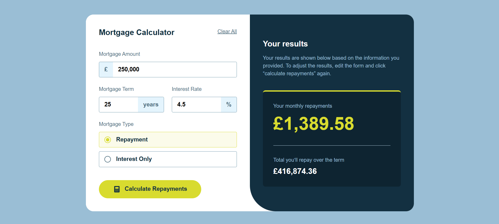
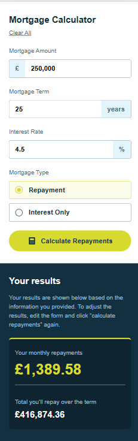
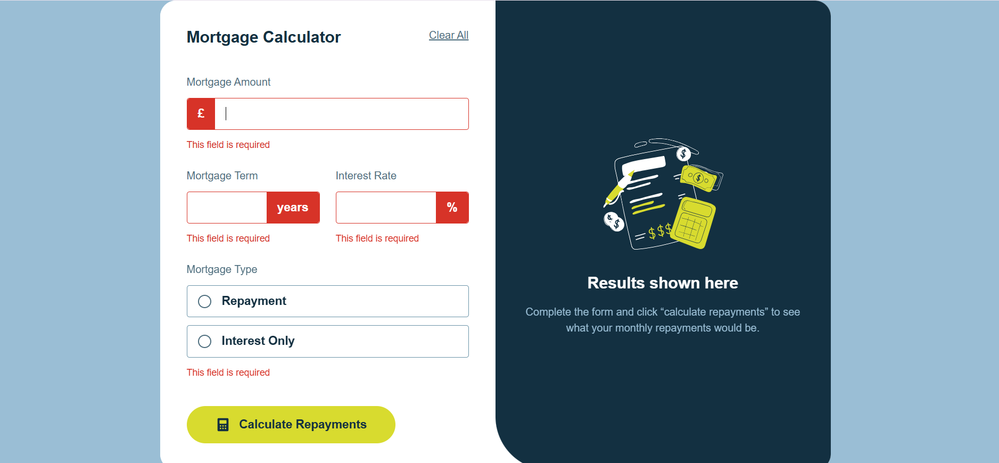

# Frontend Mentor - Mortgage Repayment Calculator

This is my solution to the [Mortgage Repayment Calculator challenge](https://www.frontendmentor.io/challenges/mortgage-repayment-calculator-Galx1LXK73) on Frontend Mentor.

I built this project using React and SCSS to practice form handling, validation, mortgage calculations, component communication, and responsive frontend development.

## Table of Contents

- [Overview](#overview)
  - [The Challenge](#the-challenge)
  - [Screenshots](#screenshots)
  - [Links](#links)
- [My Process](#my-process)
  - [Built With](#built-with)
  - [What I Learned](#what-i-learned)
  - [Challenges](#challenges)
  - [Continued Development](#continued-development)
- [Useful Resources](#useful-resources)
- [AI Collaboration](#ai-collaboration)
- [Author](#author)

## Overview

### The Challenge

Users should be able to:

- Enter mortgage information and calculate their monthly repayments and total repayment.
- See validation messages when required fields are incomplete or invalid.
- Choose between repayment and interest-only mortgage types.
- Complete the form using only their keyboard.
- View a responsive layout across different screen sizes.
- See hover and focus states for interactive elements.

### Screenshots

**Repayment Mortgage - Desktop**



**Repayment Mortgage - Mobile**



**Interest-Only Mortgage**


**Form Validation Errors**



### Links

- **Live Site:** [View the Mortgage Repayment Calculator](https://selessawy01.github.io/mortgage-calculator/)
- **GitHub Repository:** [View the source code](https://github.com/Selessawy01/mortgage-calculator)
- **Frontend Mentor Profile:** [@Selessawy01](https://www.frontendmentor.io/profile/Selessawy01)
- **Frontend Mentor Challenge:** [Mortgage Repayment Calculator](https://www.frontendmentor.io/challenges/mortgage-repayment-calculator-Galx1LXK73)
- **My Solution:** [Add your submitted solution URL here](https://www.frontendmentor.io/solutions/mortgage-solution-HoBEsqMdY3)

## My Process

### Built With

- Semantic HTML5
- React
- JavaScript (ES6+)
- SCSS / Sass
- CSS custom properties
- Flexbox
- CSS Grid
- CSS `clamp()` for fluid sizing
- CSS `:focus-visible` and `:has()` selectors
- React Hooks (`useState`)
- Vite
- Mobile-first workflow

### What I Learned

This project helped me improve my understanding of React, particularly managing form state, handling validation, performing calculations, and passing data between components.

**1. Managing Form State in React**

I used `useState` to manage the mortgage inputs and validation errors. I also practiced passing callback functions between components to share calculated results.

**2. Form Validation**

I implemented custom validation to check that required fields contain valid values before performing calculations. I learned how to display error messages and apply error styles dynamically.

**3. Mortgage Calculations**

I learned how to calculate monthly repayments using the mortgage repayment formula and how the calculation differs between repayment and interest-only mortgages.

For a repayment mortgage, the monthly payment is calculated using:

```text
M = P × [r(1 + r)^n] / [(1 + r)^n - 1]
```

Where:

- `P` is the mortgage principal.
- `r` is the monthly interest rate.
- `n` is the total number of monthly payments.

I also handled the special case of a zero-interest mortgage to avoid division by zero.

**4. Component Communication**

I separated the form and results into different React components. I used props and callback functions to pass calculated values from the form to the results section.

**5. Accessibility**

I practiced improving accessibility by using semantic HTML, labels, fieldsets, keyboard focus indicators, ARIA attributes, and screen reader testing with Windows Narrator.

**6. Responsive SCSS**

I improved my use of Flexbox, CSS Grid, responsive breakpoints, and `clamp()` to create a layout that adapts to different screen sizes.

### Challenges

One of the main challenges was implementing the mortgage calculations correctly, especially handling different mortgage types and the zero-interest case. I overcame this by researching the formulas and testing the calculations with different values.

I also found managing React state challenging, particularly keeping form inputs, validation errors, and calculated results in sync across components. I worked through this by breaking the functionality into smaller steps and using props and callback functions to communicate between components.

Another challenge was making the application responsive and accessible. I refined the SCSS layout for different screen sizes, improved keyboard focus states, and tested the application using Windows Narrator.

These challenges helped me improve my problem-solving skills and become more confident with React and frontend development.

### Continued Development

I want to continue improving my skills in:

- React component architecture and reusable components.
- Managing and organizing state in larger React applications.
- Form validation and accessible error handling.
- Accessibility testing with different screen readers.
- Writing clean, maintainable SCSS.
- Improving responsive layouts and CSS architecture.

## Useful Resources

- [React Documentation](https://react.dev/) - Helped me understand React components, state, and props.
- [MDN Web Docs](https://developer.mozilla.org/) - A useful reference for JavaScript, CSS, HTML, and accessibility.
- [Sass Documentation](https://sass-lang.com/documentation/) - Helped me work with SCSS and organize stylesheets.
- [Frontend Mentor](https://www.frontendmentor.io/) - Provided the design challenge and an opportunity to practice building a realistic project.

## AI Collaboration

I used ChatGPT as a learning and debugging assistant throughout this project.

I mainly used it to:

- Understand React concepts such as state, props, and callback functions.
- Debug form validation and mortgage calculation logic.
- Review my SCSS structure and responsive layouts.
- Improve keyboard accessibility and screen reader support.
- Understand the reasoning behind code changes rather than simply copying solutions.

I wrote and implemented the project myself, using AI guidance to understand problems, explore solutions, and improve my code.

## Author

- GitHub: [@Selessawy01](https://github.com/Selessawy01)
- Frontend Mentor: [@Selessawy01](https://www.frontendmentor.io/profile/Selessawy01)